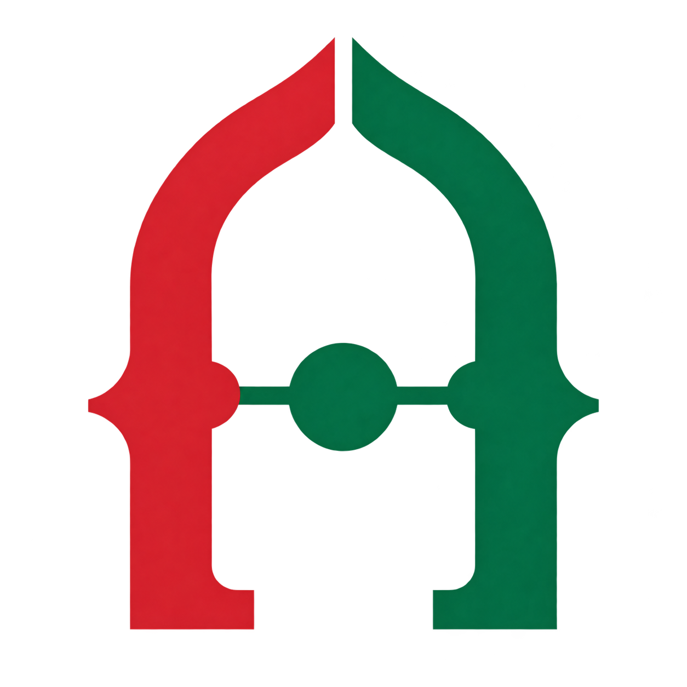

# MoroccoAPI



> Reliable, developer-friendly access to Morocco's public open data.

[](#project-status)
[](LICENSE)
[](#data-licensing)

MoroccoAPI is a community-driven, open-source project that turns reusable Moroccan public datasets into consistent, documented, and versioned APIs.

Public information is often distributed across spreadsheets, documents, portals, and incompatible schemas. MoroccoAPI aims to make approved open datasets easier to discover and use while preserving source attribution, licensing, provenance, and update history.

[Website](https://moroccoapi.dev) · [API documentation](https://moroccoapi.dev/docs) · [Releases](https://github.com/MoroccoAPI/MoroccoAPI/releases)

## Run locally

Requirements: Node.js 22 or newer and npm.

```bash
npm install
npm run dev
```

The homepage starts at `http://127.0.0.1:3000`; interactive documentation is at `http://127.0.0.1:3000/docs`.

The reference is available in French (default), English (`/docs?lang=en`), and Arabic (`/docs?lang=ar`, right-to-left). It includes endpoint search, request parameters, cURL/JavaScript examples, and a GET playground against the current server. JSON keys and source data keep their original language. The machine-readable contract remains at `/openapi.json`.

The canonical API base path is `/api/v2`. Existing `/api/v1` paths remain compatibility aliases, including the currently published pagination behavior; no removal date is scheduled. See [Migrating to API v2](docs/MIGRATING_TO_V2.md). Every nested response field is explained in all three documentation languages, including source metadata, pagination, errors, units and Moroccan administrative terms.

Documentation also has permanent URLs such as `/docs/fr/regions`, `/docs/en/postal-codes`, and `/docs/ar/dams`. The old `/docs` links still work. Light/dark mode follows the system until a visitor chooses a preference, which is saved across pages. The documentation uses larger text and a collapsible resource drawer on narrow screens.

Search metadata includes per-page titles and descriptions, canonical URLs, reciprocal language alternatives, Open Graph cards, and structured data. `/sitemap.xml` lists the homepage and every translated reference page; `/robots.txt` points crawlers to it. Canonical URLs use `https://moroccoapi.dev`, independently of request headers. After publishing, verify the domain in Google Search Console and submit `https://moroccoapi.dev/sitemap.xml`. Local changes cannot affect public indexing; indexing and ranking are determined by search engines.

Before opening a pull request, run:

```bash
npm run check
```

## Principles

1. **Source first:** every field must be traceable to an identified source.
2. **License before code:** a dataset is not integrated until redistribution rights are documented.
3. **Stable contracts:** breaking changes require a new API version.
4. **No personal-data lookup:** MoroccoAPI will not expose CIN, phone, address, or citizen profile.
5. **Multilingual by design:** Arabic, French, and English names are supported when reliable translations exist.
6. **Freshness is visible:** responses identify the source and relevant update dates.
7. **Community governance:** decisions and changes are discussed publicly.

## Data licensing

Source code and data have separate licenses:

- Project code is available under the Apache License 2.0.
- Adapted databases derived from ODbL sources will be published under ODbL 1.0.
- Third-party datasets keep their original licenses and notices.
- Incompatible or unclear sources will not be merged into the public database.

## Acknowledgements

MoroccoAPI is inspired by community public-data projects such as BrasilAPI. Inspiration does not imply affiliation.
